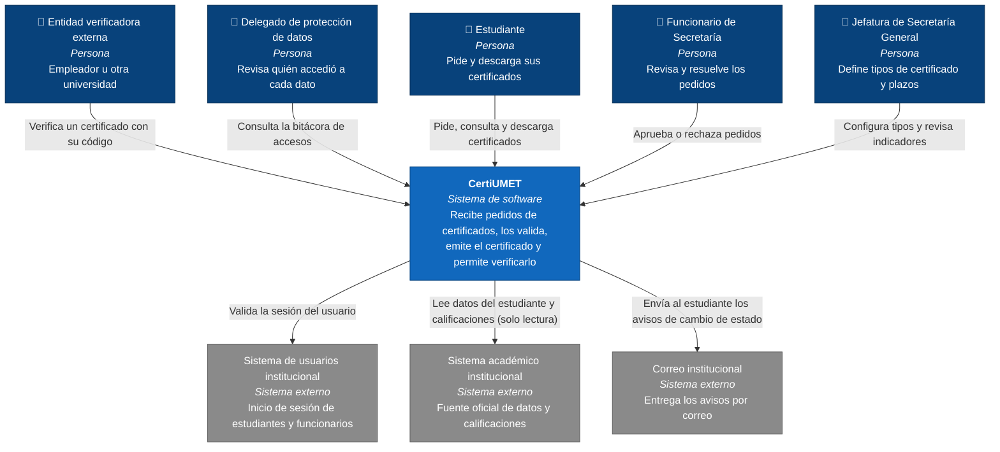

# Vista C4 · Nivel 1: Contexto del sistema

**Para quién es:** Secretaría General, jefatura, delegado de protección de datos y cualquier persona no técnica.
**Qué muestra:** el sistema CertiUMET como una sola caja, las personas que lo usan y los sistemas externos con los que se comunica. En este nivel no se nombran tecnologías (Brown, s. f.).
**Decisiones que refleja:** ADR-002 (el sistema académico solo se lee) y ADR-003 (CertiUMET es un solo sistema).

## Elementos del diagrama

| Elemento | Tipo | Responsabilidad | Stakeholder o restricción |
|---|---|---|---|
| Estudiante | Persona | Pide certificados, revisa el estado y descarga el PDF | S1 |
| Funcionario de Secretaría | Persona | Revisa los datos y aprueba o rechaza cada pedido | S2 |
| Jefatura de Secretaría General | Persona | Define tipos de certificado y plazos, y revisa indicadores | S3 |
| Delegado de protección de datos | Persona | Revisa la bitácora de accesos a datos personales | S4, R1 |
| Entidad verificadora externa | Persona | Comprueba si un certificado es auténtico | S5 |
| CertiUMET | Sistema de software | Gestiona el pedido, la emisión y la verificación de certificados | Todo el caso |
| Sistema de usuarios institucional | Sistema externo | Confirma la identidad de quien inicia sesión | A2 |
| Sistema académico institucional | Sistema externo | Entrega los datos y calificaciones oficiales; CertiUMET solo los lee | S6, R2, A1 |
| Correo institucional | Sistema externo | Hace llegar los avisos al estudiante | R6 |

## Relación con los escenarios de calidad

| Escenario | Dónde se ve en este nivel |
|---|---|
| EC-01, EC-04 | El delegado de protección de datos consulta la bitácora; solo personas autenticadas acceden a datos personales |
| EC-03 | La entidad externa verifica certificados sin iniciar sesión y sin acceso a calificaciones |
| EC-05, EC-06 | La comunicación con el sistema académico es de solo lectura y pasa por un único punto |

## Referencias

Brown, S. (s. f.). *The C4 model for visualising software architecture*. https://c4model.com
