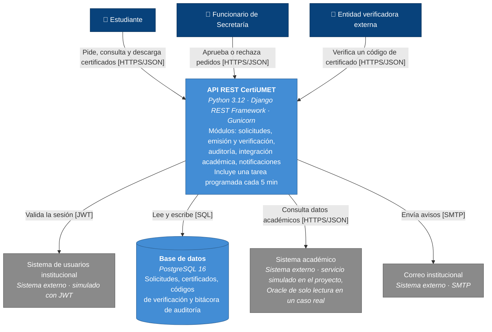

# Vista C4 · Nivel 2: Contenedores

**Para quién es:** desarrollador, Dirección de TI y evaluador técnico.
**Qué muestra:** las partes que se despliegan por separado dentro de CertiUMET, la tecnología de cada una y cómo se comunican (Brown, s. f.).
**Decisiones que refleja:** ADR-001 (PostgreSQL), ADR-002 (puerto y adaptador hacia el sistema académico) y ADR-003 (monolito modular con arquitectura hexagonal: una sola API con módulos internos).

> **Leyenda:** azul oscuro = personas; azul claro = contenedores que forman CertiUMET (límite del sistema); gris = sistemas externos.
>
> En este nivel se muestran solo tres personas para que el diagrama se lea con facilidad. La jefatura y el delegado de protección de datos usan la misma API REST que el funcionario, como se ve en el nivel 1.

## Contenedores

La tarea programada se ejecuta dentro del contenedor de la API para mantener un despliegue simple (R5, E-08). Si el volumen creciera, podría separarse en un contenedor propio sin cambiar el código, porque usa los mismos módulos.

| Contenedor | Tecnología | Responsabilidad | ADR |
|---|---|---|---|
| API REST CertiUMET | Python 3.12, Django REST Framework, Gunicorn | Atiende los endpoints CU-01 a CU-05; controla el acceso por dueño del pedido; registra cada operación en la bitácora; emite y verifica certificados; es el **único** contenedor que se comunica con el sistema académico y con el correo. Dentro del mismo contenedor, `cron` ejecuta cada 5 minutos un comando de Django que reintenta la validación de pedidos en `EN_VALIDACION` (máximo 6 veces) y envía los avisos en cola | ADR-003, ADR-002 |
| Base de datos | PostgreSQL 16 | Guarda pedidos, certificados (con restricción `UNIQUE` por pedido), códigos de verificación y bitácora de auditoría; no guarda calificaciones | ADR-001, ADR-002 |

## Sistemas externos

| Sistema | En el proyecto | En un caso real |
|---|---|---|
| Sistema de usuarios institucional | Tokens JWT generados para pruebas | Proveedor de identidad de la universidad |
| Sistema académico | Servicio simulado con datos ficticios, en su propio contenedor | Vista de solo lectura del sistema académico (Oracle) |
| Correo institucional | Servidor SMTP de pruebas | Correo institucional |

## Relación con los escenarios de calidad

| Escenario | Qué parte del diagrama lo atiende |
|---|---|
| E-01 Confidencialidad | La API valida el token y el dueño del pedido antes de responder |
| E-02 Integridad | La API y la base de datos: transacción con bloqueo de fila y `UNIQUE` (ADR-001) |
| E-03 Autenticidad | La API firma y verifica los códigos; la base guarda solo el código y el hash del documento |
| E-04 Responsabilidad | La bitácora se guarda en la misma transacción que la operación |
| E-05 Modificabilidad | Solo la API habla con el sistema académico, y lo hace por un solo adaptador (ADR-002) |
| E-06 Tolerancia a fallos | La tarea programada de la API reintenta las validaciones; la consulta de estado solo depende de la API y la base de datos |
| E-07 Desempeño | La API corre con varios procesos de Gunicorn |
| E-08 Instalabilidad | Un `docker-compose.yml` con cuatro contenedores: API, PostgreSQL, servicio académico simulado y SMTP de pruebas |

## Referencias

Brown, S. (s. f.). *The C4 model for visualising software architecture*. https://c4model.com
