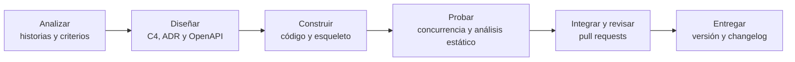

# 06 · Mapa de toolchain: priorización de tareas de alto volumen con herramientas CASE

**Proyecto:** CertiUMET API · **Semana:** 2 · **Fecha:** 22/10/2026
**Documentos relacionados:** `01-contexto-y-drivers.md` (S, R, D y E-01 a E-08), `03-adr/` (ADR-001 a ADR-004), `07-historias-y-criterios.md` (HU y CA)

Desde esta semana el análisis cambia de objeto: ya no se estudia el producto, sino el proceso para construirlo y verificarlo, con el fin de decidir qué tareas conviene apoyar con herramientas CASE (herramientas que asisten las actividades del desarrollo de software). Las etapas siguen los procesos técnicos de ISO/IEC/IEEE 12207 (ISO/IEC/IEEE, 2017) y la selección de herramientas toma como base ISO/IEC 14102 (ISO/IEC, 2008).

**Identificadores nuevos:** T = tarea de alto volumen (T01 a T10). Los identificadores S, R, D, E, A, CU y ADR se conservan.

| Elemento | Estado al iniciar la semana 2 |
|---|---|
| Sistema y arquitectura | Monolito modular con arquitectura hexagonal (ADR-003); stakeholders S1 a S7, drivers D1 a D6 y escenarios E-01 a E-08 |
| Artefactos existentes | Dossier etiquetado `v0.1.0`: `docs/01`, `docs/02-vistas-c4/`, `docs/03-adr/` y `docs/04-registro-ia.md` |
| Artefactos que se reutilizan | E-01 a E-04 y E-07 como fuente de los criterios; C4 nivel 2 como límite de la API; ADR-001 (`UNIQUE` y bloqueo por fila) |
| Alcance del esqueleto ejecutable | Casos de uso CU-03 (resolver pedido, eje de E-02) y CU-05 (verificar certificado, E-03). La tarea programada de reintentos (E-06), el envío de correo y la conexión real con el sistema académico quedan como extensión posterior |

## Paso 1 · Proceso del proyecto

El proyecto es individual (R5): el estudiante asume todos los roles. Se indica el rol para saber qué tipo de trabajo se hace en cada etapa.

| Etapa | Artefactos | Rol responsable |
|---|---|---|
| Analizar | Historias de usuario con criterios de aceptación en Gherkin; matriz de trazabilidad; issues en GitHub | Analista (Xavier Guaygua) |
| Diseñar | Vistas C4, ADR y contrato OpenAPI | Arquitecto y responsable CASE (Xavier Guaygua) |
| Construir | Código de los módulos y esqueleto ejecutable con pruebas | Desarrollador (Xavier Guaygua) |
| Probar | Pruebas de concurrencia (E-02) y de aceptación; análisis estático | Responsable de calidad (Xavier Guaygua) |
| Integrar y revisar | Pull requests revisados con una lista de revisión; revisión cruzada de un compañero del módulo | Responsable del repositorio (Xavier Guaygua) |
| Entregar | Versión etiquetada (SemVer), changelog y documentación publicada | Responsable de versiones (Xavier Guaygua) |

## Paso 2 · Diez tareas del proceso

Una tarea de alto volumen es repetitiva, frecuente, propensa a error y verificable.

| ID | Etapa | Tarea concreta | Frecuencia |
|---|---|---|---|
| T01 | Analizar | Redactar los criterios de aceptación en Gherkin a partir de los escenarios, conservando su medida | Por cada historia |
| T02 | Analizar | Mantener la trazabilidad HU → E → CA → endpoint → ADR | Con cada historia, escenario, endpoint o ADR nuevo o modificado |
| T03 | Diseñar | Actualizar los diagramas C4 como código al cambiar la arquitectura | Cuando un ADR cambia contenedores o relaciones |
| T04 | Diseñar | Validar el contrato OpenAPI con un linter | En cada cambio del contrato |
| T05 | Diseñar | Generar la documentación y el servidor mock a partir del contrato | En cada cambio del contrato |
| T06 | Construir | Crear el código base (stubs) de cada endpoint a partir del contrato | Por cada endpoint y al regenerar tras un cambio del contrato |
| T07 | Probar | Escribir y ejecutar las pruebas de concurrencia y de aceptación de E-02 contra PostgreSQL | En cada cambio del módulo de emisión |
| T08 | Probar | Ejecutar el linter del código y las reglas de dependencia entre módulos | En cada commit |
| T09 | Integrar y revisar | Revisar cada cambio por pull request con una lista de revisión | Por cada cambio a integrar |
| T10 | Entregar | Generar el changelog y el número de versión (SemVer) | En cada versión |

## Paso 3 · Puntuación Frecuencia × Esfuerzo × Riesgo

Cada factor va de 1 a 5; los valores 2 y 4 se usan cuando la tarea queda entre dos descripciones. El puntaje es el producto de los tres (máximo 125). Prioridad: **Alta** desde 60; **Media** de 20 a 59; **Baja** hasta 19.

| Criterio | 1 | 3 | 5 |
|---|---|---|---|
| Frecuencia (F) | Una vez en el proyecto | Una vez por semana | En cada commit o varias veces al día |
| Esfuerzo hecho a mano (E) | Una acción simple | Varios pasos manuales | Muchos pasos manuales que se repiten |
| Riesgo si falla (R) | Se corrige sin consecuencias | Afecta un escenario de prioridad 3 o 4 (E-06, E-07, E-08) | Afecta un escenario de prioridad 1 (E-01 o E-02) |

El valor 4 en riesgo corresponde a los escenarios de prioridad 2 (E-03, E-04 y E-05).

| ID | Tarea | F | E | R | Puntaje | Prioridad |
|---|---|---|---|---|---|---|
| T01 | Criterios de aceptación en Gherkin | 3 | 3 | 2 | 18 | Baja |
| T02 | Trazabilidad HU → ADR | 3 | 3 | 3 | 27 | Media |
| T03 | Actualizar los diagramas C4 | 2 | 3 | 1 | 6 | Baja |
| T04 | Validar el contrato OpenAPI | 4 | 4 | 4 | 64 | **Alta** |
| T05 | Documentación y mock desde el contrato | 4 | 3 | 2 | 24 | Media |
| T06 | Código base de los endpoints | 4 | 4 | 3 | 48 | Media |
| T07 | Pruebas de concurrencia y aceptación (E-02) | 4 | 5 | 5 | 100 | **Alta** |
| T08 | Linter y reglas de dependencia | 5 | 2 | 3 | 30 | Media |
| T09 | Revisar pull requests | 4 | 3 | 3 | 36 | Media |
| T10 | Changelog y versión | 2 | 2 | 2 | 8 | Baja |

**Justificación de cada puntuación (hecho observable)**

| ID | Frecuencia (F) | Esfuerzo (E) | Riesgo (R) |
|---|---|---|---|
| T01 | 3: una vez por historia; son cinco historias repartidas en la semana | 3: pasar cada escenario a Dado / Cuando / Entonces sin perder su medida | 2: un criterio mal escrito se detecta al revisar la historia con la lista del 29148 |
| T02 | 3: se actualiza con cada historia, escenario, endpoint o ADR nuevo | 3: cruzar a mano cinco artefactos (`01`, `07`, `openapi.yaml`, ADR y issues) | 3: una trazabilidad rota no detiene la API, pero oculta qué ADR revisar cuando cambia un escenario |
| T03 | 2: solo cuando un ADR cambia contenedores o relaciones (hay cuatro ADR y solo el ADR-003 lo hizo) | 3: editar el código Mermaid y comprobar que se dibuja sin cruces | 1: un diagrama desactualizado se corrige sin afectar escenarios |
| T04 | 4: en cada cambio del contrato, varias veces por semana mientras se diseña | 4: revisar a mano rutas, métodos, esquemas y códigos de estado de cinco endpoints | 4: el contrato fija la forma de los endpoints que protege E-05 y el endpoint público de E-03; un error pasa al código y a las pruebas |
| T05 | 4: en cada cambio del contrato, igual que T04 | 3: generar la documentación y levantar el mock son varios pasos manuales | 2: no afecta escenarios; un mock desactualizado se nota al compararlo con el contrato |
| T06 | 4: hay cinco endpoints y se regeneran en cada cambio del contrato | 4: crear a mano rutas, serializadores y validaciones de cada endpoint | 3: un stub incorrecto se detecta en las pruebas, pero puede afectar a E-02 de forma indirecta |
| T07 | 4: en cada cambio del módulo de emisión | 5: 1 000 pares de aprobaciones simultáneas sobre la base de datos real; imposible a mano | 5: afecta a E-02 (0 certificados duplicados en 1 000 pares de aprobaciones simultáneas) |
| T08 | 5: en cada commit | 2: un comando por herramienta | 3: detecta errores antes de integrar y controla los límites entre módulos (ADR-003), pero por sí solo no garantiza E-01 ni E-02 |
| T09 | 4: cada cambio entra por pull request, varias veces por semana | 3: leer el cambio, revisar la lista y repetir el ciclo | 3: una revisión omitida deja pasar defectos, aunque las pruebas y el linter actúan como segunda barrera |
| T10 | 2: solo en cada versión (`v0.2.0`, `v0.3.0`…) | 2: un comando y una revisión breve | 2: un changelog incorrecto se corrige en la siguiente versión sin afectar escenarios |

**Tareas priorizadas:** las tres de mayor puntaje son **T07 (100)**, **T04 (64)** y **T06 (48)**. Solo T07 y T04 llegan a prioridad Alta; T06 entra por orden de puntaje.

## Paso 4 · Herramienta candidata por fase

Upper CASE apoya el análisis y el diseño; Lower CASE apoya la construcción, las pruebas y el mantenimiento; I-CASE integra ambas sobre un repositorio común (Pressman y Maxim, 2020). La categoría depende de la función que cumple la herramienta en esa fase. Las herramientas son candidatas: la selección final se hace con la matriz ponderada (ISO/IEC 14102).

| Fase | Tarea de mayor puntaje | Puntaje | Herramienta candidata | Categoría |
|---|---|---|---|---|
| Analizar | T02 Trazabilidad HU → ADR | 27 | GitHub Issues y Projects | Upper CASE |
| Diseñar | T04 Contrato OpenAPI | 64 | Swagger Editor y Spectral | Upper CASE |
| Construir | T06 Código base de endpoints | 48 | OpenAPI Generator | Lower CASE |
| Probar | T07 Pruebas de concurrencia y aceptación (E-02) | 100 | pytest y pytest-bdd, con Claude como asistente de IA que propone casos de prueba | Lower CASE |
| Integrar y revisar | T09 Revisión de pull requests | 36 | GitHub (pull requests) con lista de revisión y GitHub Actions | I-CASE |
| Entregar | T10 Changelog y versión | 8 | Etiquetas y releases de Git y GitHub (Chacon y Straub, 2014) | Lower CASE |

**Tareas priorizadas y habilitantes.** Las pruebas de herramientas y el registro de evidencia se concentran en T07, T04 y T06. Las tareas habilitantes se ejecutan aunque su puntaje sea menor, porque la cadena las necesita: T01 (alimenta las pruebas), T02 (trazabilidad), T05 (mock del contrato), T08 (linter) y T09 (revisión).

| Tarea | Tipo | Herramienta | Riesgo de uso | Cómo se verifica |
|---|---|---|---|---|
| T07 Pruebas | Priorizada | pytest y pytest-bdd, con Claude que propone casos | Alto | Ejecutar la prueba de concurrencia sobre PostgreSQL: 0 certificados duplicados en 1 000 pares de aprobaciones simultáneas (E-02) |
| T04 Contrato | Priorizada | Swagger Editor y Spectral | Medio | Spectral sin errores y contrato contrastado con las historias del `07` |
| T06 Código base | Priorizada | OpenAPI Generator | Medio | El esqueleto arranca y sus rutas, métodos y códigos de estado coinciden con el contrato |
| T02 Trazabilidad | Habilitante | GitHub Issues y Projects | Medio | Cada historia tiene escenario, criterios, endpoint y ADR; cada commit cita el número de su issue |
| T01 Criterios | Habilitante | Gherkin (archivos `.feature`) con borrador de IA revisado | Medio | Cada criterio conserva la medida de su escenario (por ejemplo, E-02: 0 duplicados en 1 000 pares) |
| T05 Documentación y mock | Habilitante | Prism (mock) y OpenAPI Generator (documentación) | Bajo | El mock responde con los esquemas y códigos del contrato (por ejemplo, 409 al aprobar un pedido ya aprobado) |
| T08 Linter | Habilitante | ruff e import-linter | Bajo | Ejecución sin errores y resultado registrado; se automatiza después en GitHub Actions |
| T09 Revisión | Habilitante | GitHub (pull requests) con lista de revisión | Medio | Lista de revisión aplicada y comprobaciones sin errores antes de aprobar |
| T10 Changelog | Diferida | Etiquetas de Git; generador de changelog por definir | Bajo | Revisar el changelog y el número de versión contra los commits |

El riesgo de uso es el riesgo de confiar en la herramienta sin comprobar su resultado. Es alto en T07 porque una prueba propuesta por IA puede dar falsa seguridad sobre E-02.

**Dependencia del stack.** Dependen del stack (Python 3.12 y Django REST Framework, ADR-003): OpenAPI Generator (T06), pytest y pytest-bdd (T07) y ruff e import-linter (T08). No dependen del lenguaje: GitHub, Swagger Editor, Spectral y Prism. OpenAPI Generator no tiene un generador de servidor propio para Django; en la prueba de T06 se registra qué generador se usa y qué falta adaptar. T03 no se ejecuta esta semana y se actualiza solo si un ADR cambia la arquitectura.

## Paso 5 · Conexión del mapa con el trabajo de la semana

| Práctica | Tareas del mapa | Herramientas | Artefacto del dossier que usa |
|---|---|---|---|
| Del requisito al contrato | T01, T02, T04, T05 | Gherkin, GitHub Issues y Projects, Swagger Editor, Spectral y Prism | E-01 a E-04 y E-07 como criterios; C4 nivel 2 como límite de la API; ADR-001 y ADR-003 en la trazabilidad |
| Generar y verificar | T06, T07, T08, T09 | OpenAPI Generator, pytest y pytest-bdd, Claude, ruff, import-linter y pull requests | Medida de E-02 como prueba de aceptación; ADR-001 (`UNIQUE` y bloqueo por fila); contrato y criterios del `07` |

## Registro de evidencia de las herramientas

Se instalan las herramientas de las tres tareas priorizadas y se prueban con un ejemplo mínimo; al menos una es de IA. Los resultados se copian tal como salen en la terminal.

| Tarea y herramienta | Fecha | Tiempo | Qué funcionó | Qué falló | Riesgo observado | Evidencia |
|---|---|---|---|---|---|---|
| T07 · pytest + PostgreSQL 16 | _(pendiente)_ | | | | | |
| T07 · Claude (IA) | _(pendiente)_ | | | | | |
| T04 · Spectral | _(pendiente)_ | | | | | |
| T06 · OpenAPI Generator | _(pendiente)_ | | | | | |

## Referencias

Chacon, S., y Straub, B. (2014). *Pro Git* (2.ª ed.). Apress. https://git-scm.com/book/es/v2

ISO/IEC. (2008). *ISO/IEC 14102:2008 Information technology — Guideline for the evaluation and selection of CASE tools*. International Organization for Standardization.

ISO/IEC/IEEE. (2017). *ISO/IEC/IEEE 12207:2017 Systems and software engineering — Software life cycle processes*. International Organization for Standardization.

Pressman, R. S., y Maxim, B. R. (2020). *Software engineering: A practitioner's approach* (9.ª ed.). McGraw-Hill Education.
