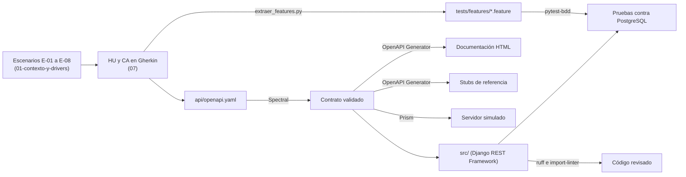

# 08 · Informe final de la cadena CASE

**Proyecto:** CertiUMET API · **Semana:** 2 · **Versión:** `v0.2.0` · **Fecha:** 23/10/2026
**Documentos relacionados:** `06-mapa-toolchain.md` (mapa y evidencia), `07-historias-y-criterios.md` (HU y CA), `api/openapi.yaml`, `03-adr/ADR-004`, `04-registro-ia.md`, `docs/evidencias/`

## 1. Resumen

Esta semana se armó y se ejecutó la cadena CASE completa del proyecto: de los escenarios de calidad del dossier se pasó a cinco historias de usuario con quince criterios en Gherkin, de ahí a un contrato OpenAPI con cinco endpoints y, desde el contrato, a la documentación, el servidor simulado, el código base y un esqueleto Django con pruebas que salen de los mismos criterios. Toda la cadena corre con un solo comando (`bash scripts/cadena.sh`), que guarda la salida de cada herramienta en `docs/evidencias/`.

Resultado de la ejecución del 23/10/2026 en el equipo del estudiante (WSL2 con Ubuntu, Python 3.10.12 y PostgreSQL 16):

| Eslabón | Herramienta | Resultado observado | Evidencia |
|---|---|---|---|
| Criterios → pruebas | `scripts/extraer_features.py` | Los 5 archivos `.feature` coinciden con el `07` | `01-features.txt` |
| Contrato | Spectral 6.17.0 | 0 errores, 0 avisos | `02-spectral.txt` |
| Documentación | OpenAPI Generator 7.26.0 (`html2`) | `docs/api/index.html` generado | `03-documentacion.txt` |
| Stubs | OpenAPI Generator 7.26.0 (`python-fastapi`) | 24 archivos Python generados en `api/stubs/` | `04-stubs.txt` |
| Mock | Prism 5.15.11 | Responde 201, 422, 401, 409 y 200 según el contrato | `04b-prism-mock.txt` |
| Linter | ruff 0.14.14 | Sin errores | `05-ruff.txt` |
| Reglas de módulos | import-linter 2.15 | 3 contratos cumplidos, 0 rotos | `06-import-linter.txt` |
| Pruebas | pytest 8.4.2 + pytest-bdd 8.1.0 | 14 pasan, 1 excluida (`@carga`); E-02: 0 duplicados en 1 000 pares | `07-pruebas.txt` |

## 2. Mapa de la cadena

El detalle del proceso, las diez tareas con su puntuación F×E×R y la herramienta de cada fase está en el `06`. Las tres tareas priorizadas fueron T07 (pruebas de concurrencia de E-02), T04 (validación del contrato) y T06 (código base).

## 3. Artefactos producidos

| Artefacto | Ruta | Identificadores |
|---|---|---|
| Mapa de toolchain y evidencia | `docs/06-mapa-toolchain.md` | T01 a T10 |
| Historias y criterios | `docs/07-historias-y-criterios.md` | HU-01 a HU-05, CA-01.1 a CA-05.2 |
| Decisión de idioma | `docs/03-adr/ADR-004-idioma-de-los-artefactos.md` | ADR-004 |
| Contrato | `api/openapi.yaml` | 5 endpoints, uno por HU |
| Documentación generada | `docs/api/index.html` | — |
| Stubs generados | `api/stubs/python-fastapi/` | — |
| Esqueleto ejecutable | `src/` | Módulos `solicitudes`, `emision`, `auditoria`, `integracion_academica` (ADR-003) |
| Pruebas | `tests/` | Una prueba por CA, con etiquetas `@HU-0n` y `@E-0n` |
| Evidencia | `docs/evidencias/` | Salidas 01 a 10 |

**Hallazgos de la cadena**

- **T06 · Stubs.** OpenAPI Generator no tiene un generador de servidor para Django. Se generaron los stubs con `python-fastapi` y se usaron como referencia de rutas, modelos y códigos de estado; el esqueleto en Django se escribió a mano siguiendo esa referencia. Para semanas siguientes queda la opción de comparar el contrato con el esquema que produce la propia API (por ejemplo, con drf-spectacular).
- **T07 · Concurrencia.** La prueba CA-03.2 envía 1 000 pares de aprobaciones simultáneas sobre PostgreSQL y comprueba 0 certificados duplicados y 409 en las 1 000 segundas aprobaciones. Para saber si la prueba detecta el defecto que debe detectar, se quitó a propósito el bloqueo por fila (`select_for_update`): la restricción `UNIQUE` evitó los duplicados, pero la API respondió 500 en lugar de 409 y la prueba falló. Se confirmó así que las dos barreras del ADR-001 son necesarias y que la prueba no da falsa seguridad.
- **CA-01.3 (E-07).** La prueba de carga lleva la etiqueta `@carga` y se excluye de las pruebas del esqueleto; se ejecutará con una herramienta de carga en la semana 3.

## 4. Matriz de evaluación y selección de herramientas (tarea T04)

### 4.1 Cómo se hizo la prueba

La selección sigue la idea de ISO/IEC 14102: definir criterios con pesos, probar las herramientas sobre el caso real y calificar con lo observado (ISO/IEC, 2008). Se compararon tres herramientas para validar el contrato: **Spectral 6.17.0**, **Redocly CLI 2.71.0** y **Claude (Anthropic)** como revisor de IA. Para tener una medida igual para las tres, se preparó `api/pruebas/openapi-con-defectos.yaml`, una copia del contrato con **ocho defectos sembrados**: cinco de estructura (D1 a D4 y D8) y tres de significado (D5 a D7), es decir, defectos que el contrato acepta como válidos pero que no cumplen los requisitos. A Claude se le pasó el contrato y el resumen de las historias, en un chat nuevo y sin decirle qué defectos tenía.

| ID | Defecto sembrado | Tipo | Spectral | Redocly | Claude |
|---|---|---|---|---|---|
| D1 | Falta `operationId` en `GET /solicitudes/{id}` | Estructura | Sí (aviso) | Sí (aviso) | Sí |
| D2 | Etiqueta `Pedidos` sin declarar | Estructura | Sí (aviso) | No | Sí |
| D3 | `info` sin `contact` | Estructura | Sí (aviso) | No | No |
| D4 | Parámetro `idSolicitud` que no coincide con `{id}` | Estructura | Sí (error) | Sí (error) | Sí |
| D8 | Ejemplo de `fechaCreacion` que no cumple su tipo | Estructura | Sí (error) | Sí (aviso) | Sí |
| D5 | Falta la respuesta 409 en la resolución (E-02) | Significado | No | No | Sí |
| D6 | Se pide la cédula en el cuerpo (R1) | Significado | Indirecto: solo marca que el ejemplo no trae `cedula` | Indirecto: mismo aviso | Sí, lo relaciona con R1 |
| D7 | La verificación exige token aunque debe ser pública (HU-05) | Significado | No | No | Sí |
| | **Detectados de 8** | | **5 y 1 indirecto** | **3 y 1 indirecto** | **7** |

Claude además señaló cuatro puntos que no estaban sembrados y que también existían en el contrato real: el motivo de rechazo solo era obligatorio en el texto, el esquema `Verificacion` permitía campos extra, los datos de la verificación no se separaban entre válido y no válido, y la URL de la licencia no apuntaba a una licencia. Redocly dio un aviso sobre el servidor `localhost`, que en este caso no es un defecto porque el contrato describe el entorno local.

### 4.2 Criterios, pesos y calificaciones

Escala: 1 = no cumple; 3 = cumple en parte; 5 = cumple por completo. Cada calificación sale de la prueba anterior o de la ejecución de la cadena.

| Criterio | Peso | Spectral | Redocly CLI | Claude (IA) |
|---|---|---|---|---|
| C1 · Detecta defectos de estructura | 25 % | 5 · encontró los 5 | 3 · encontró 3 de 5 | 4 · encontró 4 de 5 (no vio D3) |
| C2 · Detecta defectos de significado | 25 % | 1 · ninguno directo; D6 solo por el ejemplo | 1 · igual que Spectral | 5 · encontró los 3 y los relacionó con E-02, R1 y HU-05 |
| C3 · Da el mismo resultado cada vez | 20 % | 5 · los mismos 7 hallazgos en el entorno de desarrollo y en el equipo del estudiante | 5 · los mismos 7 hallazgos en ambos entornos | 2 · respuesta en texto libre que puede cambiar entre ejecuciones; no hay forma de fijarla |
| C4 · Se integra en la cadena y en la integración continua | 20 % | 5 · CLI, código de salida 1 si hay errores, reglas en `.spectral.yaml`; ya corre en `cadena.sh` | 4 · CLI con código de salida, pero sin archivo de reglas propio dio un aviso que no aplica | 1 · se usa copiando y pegando en un chat; no da código de salida |
| C5 · Costo y licencia (R4) | 10 % | 5 · software libre (Apache 2.0), sin costo | 5 · software libre (MIT), sin costo | 3 · el uso depende de un plan del proveedor y de sus límites |
| **Puntaje ponderado (sobre 5)** | **100 %** | **4,00** | **3,30** | **3,15** |

Cálculo: puntaje = Σ (peso × calificación) ÷ 100. Por ejemplo, Spectral: 0,25·5 + 0,25·1 + 0,20·5 + 0,20·5 + 0,10·5 = 4,00.

**Prueba de sensibilidad.** Si el peso de C2 sube a 40 % (C1 20 %, C3 15 %, C4 15 %, C5 10 %), Claude pasa al primer lugar con 3,55, Spectral queda en 3,40 y Redocly en 2,85. El resultado depende de cuánto pese encontrar errores de significado, y eso respalda usar las dos herramientas juntas.

### 4.3 Selección y riesgos

**Selección:** Spectral es la herramienta de validación del contrato dentro de la cadena y será el control obligatorio en la integración continua, porque es la única que combina detección completa de estructura, resultado repetible y código de salida. Claude se usa como revisión complementaria del significado del contrato frente a las historias, antes de aprobar un cambio, y sus hallazgos los revisa siempre el estudiante. Redocly CLI no se selecciona porque no aporta algo que Spectral no haga en este caso.

| Riesgo | Herramienta | Cómo se controla |
|---|---|---|
| Confiar en que "Spectral sin errores" significa que el contrato cumple los requisitos | Spectral | La prueba mostró que no detecta D5 a D7; se mantiene la revisión del contrato contra el `07` y la lista de la 29148 |
| Que la IA invente defectos o deje pasar uno sin avisar | Claude | Cada hallazgo se comprueba contra el contrato y los requisitos; en esta prueba no detectó D3, aunque Spectral sí |
| Pegar datos personales o credenciales en la IA | Claude | El contrato no tiene datos personales y todos los ejemplos son ficticios (A4) |
| Que la respuesta de la IA cambie de una vez a otra | Claude | No se usa como control automático; la respuesta se guarda como evidencia (`10-matriz-claude.md`) |

**Cambios al contrato real tras la revisión de Claude.** Se aceptaron dos hallazgos: se agregó `additionalProperties: false` al esquema `Verificacion` y se quitó la URL de la licencia. Se rechazó, por ahora, separar las respuestas con `oneOf`, porque complica los stubs generados. Las dos reglas sí se cumplen en el código: el dominio rechaza con 422 un rechazo sin motivo (`Solicitud.rechazar`) y la prueba CA-05.2 comprueba que un código no válido devuelve solo `{"valido": false}`. Queda pendiente agregar un criterio para el rechazo sin motivo. Después de los cambios, Spectral siguió sin errores y las 14 pruebas siguieron pasando.

## 5. Uso de IA y verificación

El uso de IA de esta semana está en `04-registro-ia.md` (filas 11 a 14), con herramienta y versión, prompt, salida, defectos, decisión y verificación. Todo artefacto generado con IA se verificó con una ejecución real: el contrato con Spectral, el código con ruff e import-linter, y el comportamiento con las 14 pruebas sobre PostgreSQL.

## 6. Pendientes para la semana 3

- Prueba de carga de CA-01.3 (E-07) y tarea programada de reintentos de E-06.
- Integración continua en GitHub Actions con Spectral, ruff, import-linter y pytest como controles obligatorios.
- Revisión cruzada de las vistas C4 por un compañero del módulo.

## Referencias

Chacon, S., y Straub, B. (2014). *Pro Git* (2.ª ed.). Apress. https://git-scm.com/book/es/v2

ISO/IEC. (2008). *ISO/IEC 14102:2008 Information technology — Guideline for the evaluation and selection of CASE tools*. International Organization for Standardization.

ISO/IEC/IEEE. (2017). *ISO/IEC/IEEE 12207:2017 Systems and software engineering — Software life cycle processes*. International Organization for Standardization.

ISO/IEC/IEEE. (2018). *ISO/IEC/IEEE 29148:2018 Systems and software engineering — Life cycle processes — Requirements engineering*. International Organization for Standardization.

OpenAPI Initiative. (s. f.). *OpenAPI Specification* (v3.0.3). Linux Foundation. https://spec.openapis.org/oas/v3.0.3.html
